<!-- HEADER BANNER -->

  
  

  

  

---
# 👨‍💻 About Me

## Lawal Olayinka Awal (Ayinkx)

**Backend Engineer**
**Python · FastAPI · PostgreSQL · Stellar / Soroban**

  

---

Backend engineer focused on **Python, FastAPI and PostgreSQL**. I build production APIs and developer tools, with a growing focus on the **Stellar / Soroban** ecosystem.

- 🎯 **Focus Areas:** Backend Architecture, API Design, Developer Experience, Automated Testing
- 🚀 **Building:** [Social Autopilot](https://www.socialautopilot.online/) — a live multi-account publishing SaaS for seven platforms, with scheduling, recurring posts, team workspaces and 360+ tests
- 🧩 **Contributing:** Stellar / Soroban open source — contract inspection, security analysis and upgrade-verification tooling
- 💼 **Open To:** Backend / Python roles and open-source collaboration
- 📬 **Contact:** olayinkaawal00@gmail.com

---

  <h2 style="font-size: 28px !important; font-weight: bold; margin: 0 0 5px 0; line-height: 1.5;">
    🌐 Socials:
  </h2>
  

  
  
  
  
  
  

---
## 🚀 Featured Project

<table>
  <tr>
    <td width="50%" valign="top">
      <h3>📅 Social Autopilot</h3>
      
A live multi-account publishing SaaS for YouTube, TikTok, Facebook, Instagram, Threads, LinkedIn and X. Includes scheduling, recurring posts, team workspaces and 360+ tests.

      

        
        
        
        
      

      

        
        
      

    </td>
    <td width="50%" valign="top">
      <h3>🤖 AI Code Assistant</h3>
      
Open-source AI coding assistant with read-only Stellar/Soroban tooling: XDR decoding, RPC/Horizon inspection, contract scaffolds and a plugin system.

      

        
        
        
      

      

        
      

    </td>
  </tr>
</table>

---

## 🧰 Tech Stack

**Languages**

  
  
  
  

**Backend & Data**

  
  
  
  
  
  

**Stellar / Soroban**

  
  
  

**Tooling & Platform**

  
  
  
  

---

## 📊 GitHub Stats

  

---

## 💻 Spent My Time

  

---

## 📈 Contribution Activity

  

  <picture>
    <source media="(prefers-color-scheme: dark)" srcset="https://raw.githubusercontent.com/Ayinkx/Ayinkx/output/snake-dark.svg"/>
    <source media="(prefers-color-scheme: light)" srcset="https://raw.githubusercontent.com/Ayinkx/Ayinkx/output/snake.svg"/>
    
  </picture>

---

## 🌍 Open Source

<table>
  <tr>
    <td width="50%" valign="top">
      <h3>🔗 Contributions</h3>
      <ul>
        <li><a href="https://github.com/AnchorNet-Org/AnchorNet-Frontend/pull/272">AnchorNet-Frontend #272</a> — stored-vs-system resolution handling and outside-provider guard tests.</li>
        <li><a href="https://github.com/drydocs/meridian/pull/397">meridian #397</a> — fix plus the decision documented in <code>CONTRIBUTING.md</code>.</li>
        <li><a href="https://github.com/milepost-labs/milepost/pull/60">milepost #60</a> — payee-verification and wallet-status guards.</li>
        <li><a href="https://github.com/DayzLabs/stellar-upgrade-guard">stellar-upgrade-guard</a> — ongoing work on Soroban upgrade safety checks.</li>
      </ul>
    </td>
    <td width="50%" valign="top">
      <h3>📦 Other Projects</h3>
      <ul>
        <li><a href="https://github.com/AyinkxLab/stellar-contract-platform">Stellar Contract Platform</a> — contract intelligence for Soroban.</li>
        <li><a href="https://github.com/StellarFoundry/soroban-security-scanner">Soroban Security Scanner</a> — deterministic security analysis for Soroban contracts.</li>
        <li><a href="https://github.com/StellarFoundry/stellar-devkit">Stellar DevKit</a> — developer tooling for Stellar and Soroban.</li>
        <li><a href="https://github.com/Ayinkx/drips-wave-helper">drips-wave-helper</a> — Python CLI that finds, ranks and drafts Stellar Wave applications.</li>
      </ul>
    </td>
  </tr>
</table>

---

## Currently Exploring

* 🧠 Backend Architecture
* 🔌 API Design & Developer Experience
* 🧪 Automated Testing
* 🔐 Soroban Contract Security
* 🛠️ AI-Assisted Developer Tooling
* ☁️ Cloud-Native Backend Development
  

---

# ⭐ Support

**If you find my repositories useful, consider giving them a ⭐.**

Your feedback, suggestions, and contributions are welcome.

  <b>🐍 Python • ⚡ FastAPI • 🗄️ PostgreSQL • 🌌 Stellar / Soroban</b>

  Made with ❤️ for learning, experimentation, and continuous improvement.

---

## What I'm Looking For

I'm actively looking for **Backend Engineering**, **Python** and **API Development** opportunities where I can contribute to real-world systems, learn from experienced engineers, and build scalable products.

**If you'd like to collaborate, discuss an opportunity, or just connect, feel free to reach out.**

---

### 🌟 Clean APIs • Reliable Systems • Open Source

---

### Thanks for visiting my profile!

**If you like my work, consider giving a ⭐ to the repositories you find useful.**

 

  

  

