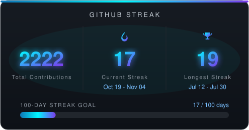

  

  Backend engineer building production APIs and developer tools — Python, FastAPI, PostgreSQL, Stellar / Soroban.

  

<h2 align="center">🧭 About Me</h2>

Backend engineer focused on **Python, FastAPI and PostgreSQL**. I build production APIs and developer tools, with a growing focus on the **Stellar / Soroban** ecosystem.

- **Building** [Social Autopilot](https://social-autopilots.vercel.app) — a live multi-account publishing SaaS for seven platforms, with scheduling, recurring posts, team workspaces and 360+ tests.
- **Contributing** to Stellar / Soroban open source — contract inspection, security analysis and upgrade-verification tooling.
- **Interested in** backend architecture, API design, developer experience and automated testing.
- **Open to** backend / Python roles and open-source collaboration.

  

<h2 align="center">🚀 Selected Projects</h2>

| Project | What it does | Stack |
| :--- | :--- | :--- |
| **[Social Autopilot](https://social-autopilots.vercel.app)** · [source](https://github.com/AyinkxLab/social-autopilot) | Multi-account publishing SaaS for YouTube, TikTok, Facebook, Instagram, Threads, LinkedIn and X. | FastAPI · PostgreSQL · Supabase · OAuth · Vercel |
| **[AI Code Assistant](https://github.com/AyinkxLab/ai-code-assistant)** | Open-source AI coding assistant with read-only Stellar/Soroban tooling: XDR decoding, RPC/Horizon inspection, contract scaffolds and a plugin system. | Python · Soroban |
| **[Stellar Contract Platform](https://github.com/AyinkxLab/stellar-contract-platform)** | Contract intelligence for Soroban: inspection, interface analysis, compatibility checks and deployment verification. | Rust · Soroban |
| **[Soroban Security Scanner](https://github.com/StellarFoundry/soroban-security-scanner)** | Deterministic security analysis for Soroban contracts and Rust projects, surfacing risky patterns before deployment. | Rust · Security |
| **[Stellar DevKit](https://github.com/StellarFoundry/stellar-devkit)** | Developer tooling for building on Stellar and Soroban: RPC, XDR/SCVal inspection, fixtures, analysis and a CLI. | Python · Soroban |
| **[drips-wave-helper](https://github.com/Ayinkx/drips-wave-helper)** | Dependency-free Python CLI that finds, ranks and drafts applications for Stellar Wave open issues. | Python · CLI |

  

<h2 align="center">🌍 Open Source</h2>

Selected contributions to projects outside my own repositories:

- [AnchorNet-Frontend #272](https://github.com/AnchorNet-Org/AnchorNet-Frontend/pull/272) — stored-vs-system resolution handling and outside-provider guard tests.
- [meridian #397](https://github.com/drydocs/meridian/pull/397) — fix plus the decision documented in `CONTRIBUTING.md`.
- [milepost #60](https://github.com/milepost-labs/milepost/pull/60) — payee-verification and wallet-status guards.
- [stellar-upgrade-guard](https://github.com/DayzLabs/stellar-upgrade-guard) — ongoing work on Soroban upgrade safety checks.

  

<h2 align="center">🧰 Tech Stack</h2>

  

  

<h2 align="center">📊 GitHub Stats</h2>

  
  

  

<h2 align="center">📈 Contribution Activity</h2>

  

  

  <picture>
    <source media="(prefers-color-scheme: dark)" srcset="https://raw.githubusercontent.com/Ayinkx/Ayinkx/output/snake-dark.svg"/>
    <source media="(prefers-color-scheme: light)" srcset="https://raw.githubusercontent.com/Ayinkx/Ayinkx/output/snake.svg"/>
    
  </picture>

  

<h2 align="center">📬 Contact</h2>

  <a href="https://ayinkx-portfolio.vercel.app">Portfolio</a> ·
  <a href="https://www.linkedin.com/in/ayinkx">LinkedIn</a> ·
  <a href="mailto:olayinkaawal00@gmail.com">Email</a> ·
  <a href="https://x.com/Ayinkx_">X</a>

  

Thanks for stopping by — always happy to talk backend, APIs and Stellar.

